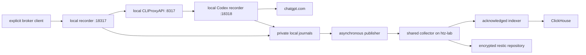

# inference retention

raw journals are authoritative; ClickHouse and replication checkpoints are
rebuildable indexes. a model reply alone proves neither archival nor backup.



## availability and enrollment

the MacBook declarations use independent local gateways, not a mini fallback.
each needs its **own fresh personal login** and an explicitly selected local
client before it can infer. never synchronize a rotating OAuth grant between
gateways. see [broker enrollment](../cli-proxy-api/README.md).

inference waits for local journal persistence, not replication, ClickHouse,
Tailscale, the mini, or backup. archive outages accumulate a local backlog until
an intentional storage limit is reached. local recorder/provider failures still
stop inference; provider account quotas are not made independent by this topology.
Linux clients may continue selecting the remote mini gateway. existing direct
connections and running CLI sessions are not silently rerouted.

## capture boundary

only explicitly broker-selected traffic is covered. direct connections, native
session history, Amp's server-side inference and other upstream providers remain
outside this boundary. there is no historical backfill or native-session export
collector. Claude needs a separate upstream recorder before equivalent coverage
can be claimed.

both loopback recorders share one writer and budget. payloads are fsynced before
forwarding; transport failures stay explicit, not successful truncated replies.
authorization, cookies, arbitrary headers and URL queries are not metadata.
management, OAuth, discovery and health bypass content capture. bodies remain
opaque: credentials pasted into a prompt are still sensitive body content.

local limits reject work rather than evict evidence: 8 GiB journal budget, 5 GiB
free-space reserve, 128 MiB per direction/exchange, 16 MiB per complete websocket
message, and 24 MiB per serialized record. these are bounds, not forecasts. there
is no TTL or automatic spool deletion after replication, indexing or backup.

journals identify HTTP exchanges or websocket **connections**, not semantic turns.
messages/control events preserve order and bytes, not TCP packets, fragmentation
or compression. `aborted` describes transport closure; `response.completed` can
precede it. reused upstream websockets retain their initial parent id; retries on
new connections receive distinct ids.

`codex-archive-route.patch` supplies the default OAuth recorder route. explicit
native per-account upstream overrides still win; SIWC/API-billing routing is
unchanged. credential websockets and the dynamic parent-header rule must be
configured and verified after each fresh enrollment. a client capability flag
alone proves neither upstream capture nor lineage.

## asynchronous collection

`replicate.ts` uploads complete LF-delimited prefixes, including active `.open`
journals. a durable receiver offset and SHA-256 must match the producer before a
private replication receipt advances. lost replies reconcile through status;
collisions, source mutation and receiver rollback fail closed without removing
source data. failures back off independently of capture.

`collector.ts` binds each UUID to an authenticated node in immutable
`origins/<UUID>.json`; raw records are not rewritten. node keys are separate from
broker and database keys. the collector fsyncs staged transactions, raw bytes,
and proof metadata before acknowledging. interrupted appends recover from the
retained transaction without truncation. its defaults are a 24 GiB total budget
and 8 GiB free reserve; exhausted capacity pauses uploads, not remote inference.

private TLS `https://htz-lab.tail1543a7.ts.net:18923/archive` reaches loopback
collector `:18925` through loopback router `:18923`. SQL paths reach private
ClickHouse `:18926`, with independent database authentication. no additional
public ingress or tailnet port is required. health is liveness; readiness checks
capacity, not index freshness or successful uploads from every node.

## indexing and raw recovery

`journal/` contains active `.open` and sealed `.jsonl` files with private modes.
producer startup marks valid unfinished exchanges incomplete; torn records and
ambiguous writer ownership block startup. do not delete locks or truncate
retained evidence to make readiness green. physical power loss is not tested.

local capture health uses `:18319`: `/ready` checks storage/writer and the backend
listener, not account health. shared indexing runs on htz-lab and never blocks
capture. queries require `FINAL` for stable-event replay/deduplication:

```sql
SELECT source_node, request_id, sequence, searchable_text
FROM inference_archive.events FINAL
WHERE positionCaseInsensitive(searchable_text, 'needle') > 0;
```

`payload_json`/`data_base64` retain bytes. searchable text is per-chunk convenience,
not exact UTF-8 reconstruction. `source_node` comes from collector provenance;
legacy journals without provenance use an empty string. inserts synchronously
request part fsync before checkpoints advance. uncertain inserts replay. sealed
receipts bind source SHA-256, not independently audited database completeness.

for database loss/rollback, preserve journals and move old `indexer/` checkpoints
aside before rebuilding. reconnecting cannot repair a database behind its ACKs.

## backup and disaster recovery

`shared-backup.nix` runs directly on htz-lab every six hours, keep-all, selecting
**journal + origins + receipts only**. its dedicated SSH identity and repository
password remain outside the archive. it verifies the existing ssd-01 repository
identity; it never initializes, prunes or forgets. the mini's older `backup.nix`
plan remains a separate journal/receipt copy, with no removable-volume dependency.
periodic backup is not a synchronous off-machine copy of every accepted byte.

restore into an isolated destination. verify sealed SHA-256 against the original
or receipt and run the sealed parser. preserve active/partial files as evidence;
a successful scheduler entry alone is not restore proof.

receiver checkpoints and transactions are not the backup contract. after checking
restored raw files and origins, keep the collector stopped and explicitly rebuild
proofs against a nonsecret configuration whose `root` is the restored directory:

```sh
node collector.ts adopt-restored /private/restored-collector.json
```

this operation validates and fsyncs raw data before creating derived proofs. it is
idempotent; ambiguous journals, conflicting existing proofs, pending transactions
and partial tails are rejected without truncation. sealed journals can then
accept idempotent producer replay. the tests include a raw-only restore that
fails before adoption and succeeds afterward.

if a restored active file has a partial tail, retain the entire restored root.
when its producer still has the full journal, stop the affected services and
move the partial file to a non-`.open`/`.jsonl` evidence name **inside `journal/`**;
preserve its origin, and move any conflicting derived proof aside. the producer
can replay into a fresh raw file without deleting the retained partial bytes.

an older receiver snapshot may be behind producers' durable replication receipts.
that rollback intentionally stops uploads. after verifying the restored root and
choosing replay, stop each affected publisher and move its old
`replication-receipts/` directory aside before restarting. do not reset source
journals. if the producer is unavailable, retain the partial restore and do not
claim missing bytes were recovered.

## operating and checking

```sh
cd modules/inference-archive
pnpm install --frozen-lockfile
pnpm run typecheck
pnpm test
```

Nix supplies prerequisites and native service wiring; programs execute the same
editable source/manifest used for installation. published source hashes change
launcher identities. native XML, keys, grants and configuration remain writable
runtime files, never Nix-store snapshots.

Darwin user-domain capture is `dev.inference-archive.capture`; publication is
`org.nix-community.home.inference-publisher`. Linux user services are
`inference-collector`, `inference-archive-router`, `inference-archive-indexer`,
`inference-archive-database`, and `inference-shared-backup` (six-hour timer).
reload only affected services. do not activate unrelated host changes merely to
install a recorder. tailnet authorization is separate from local service startup.
