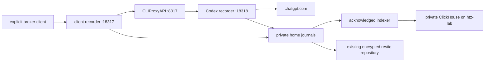

# inference retention

raw journals are authoritative; ClickHouse is a rebuildable query index. neither
CLIProxyAPI's debug logs nor a successful model reply proves that an archive or a
backup exists.



## capture boundary

only explicitly broker-selected traffic is covered. direct connections, existing
native sessions, Amp's server-side inference, and other upstream providers remain
outside this boundary. there is no historical backfill or native-session export
collector here. adding Claude later requires a separate upstream recorder before
claiming the same provider-attempt coverage.

both loopback listeners share one writer and disk budget. payload records are
fsynced before forwarding; transport failures remain explicit, not successful
truncated replies. authorization, cookies, arbitrary headers and URL queries are
not journal metadata. management, OAuth, discovery and health requests bypass
content capture. bodies are opaque: credentials pasted into a prompt are still
sensitive body content.

limits intentionally reject work rather than evict retained data: 8 GiB journal
budget, 5 GiB free-space reserve, 128 MiB per direction/exchange, and 16 MiB per
complete websocket message. these are bounds, not a measured capacity forecast.
there is no TTL, deletion or automatic spool cleanup after indexing/backup.

journals identify HTTP exchanges or websocket **connections**, not semantic model
turns. websocket messages/control events preserve order and bytes, not original
TCP packets, frame fragmentation, or compression. `aborted` describes transport
closure; a recorded `response.completed` can precede it. a reused upstream
websocket carries the connection's initial parent id, not a fresh parent per
message. retries on new connections receive distinct journal ids.

`codex-archive-route.patch` in the broker module supplies the configured default
OAuth upstream recorder. explicit native per-account upstream overrides still
win. SIWC/API-billing routing is deliberately unchanged. verify new account
routing instead of assuming a client websocket flag proves upstream capture.

## storage and recovery

`~/.local/share/inference-archive/journal/` contains `.open` exchanges and sealed
`.jsonl` files, with private directory/file modes. startup recovers valid unfinished
exchanges as incomplete; torn/corrupt records and ambiguous writer ownership block
startup. do not delete a lock or truncate evidence to make readiness green. stop
the recorder, preserve the whole root, and inspect the failed ownership/integrity
condition first. physical power-loss behavior has not been tested.

`GET /health` reports process liveness; `/ready` also checks writer/storage state
and the native broker listener. neither proves upstream account health or query
index freshness. the dedicated service probe listens on loopback `:18319`.

for database loss/rollback, retain the raw journals and move the old `indexer/`
checkpoint directory aside before rebuilding. a database restored behind its
acknowledged checkpoints cannot be repaired by merely reconnecting. stable event
ids permit replay; correctness queries require `FINAL`:

```sql
SELECT request_id, sequence, searchable_text
FROM inference_archive.events FINAL
WHERE positionCaseInsensitive(searchable_text, 'needle') > 0;
```

raw `payload_json`/`data_base64` retain bytes; searchable text is only a convenience
and can omit split UTF-8/binary data. inserts are synchronous and request part
fsync before checkpoint persistence. an ACK precedes durable checkpoints; an
uncertain result replays without losing the source. unchanged source identities
are cached between polls, with daily prefix revalidation. receipts bind sealed
source SHA-256 values, not an independently audited database-completeness claim.

## backup is separate

`backup.nix` adds a six-hour, keep-all plan for **journal + receipts only** to the
existing initialized ssd-01 repository. it does not import removable-volume hooks,
back up account grants/passwords, initialize repositories, prune, or forget data.
backup is periodic, not a synchronous remote copy of every accepted payload.

restore into a new, nonexistent destination. verify both the sealed parser and
SHA-256 against the original/receipt; a successful scheduler entry alone is not
restore evidence. the deployment's private `deployment-evidence.json` and
`restore-evidence.json` live beside the hub journals, outside the backup allowlist.

## operating and checking

install and run from the same live directory:

```sh
cd modules/inference-archive
pnpm install --frozen-lockfile
pnpm run typecheck
pnpm test
```

Nix wires prerequisites/services and installs dependencies. source/lock hashes
change launcher identities so published updates reload the relevant service;
local source edits still use normal installation and native reloads. capture is
`dev.inference-archive.capture` in the Darwin user launch domain. ClickHouse is
`inference-archive-database.service` in the Linux user manager. native XML and
passwords remain private editable runtime files, never Nix-store snapshots.

`tailscale/policy.hujson` contains narrow broker/indexer grants. applying those is
a separate permission boundary from starting local services. until applied, the
hub's automatic indexer and tagged Linux clients cannot use the denied routes;
raw capture and encrypted backup are independent. no commit/push or host switch is
implied by these local setup instructions.
