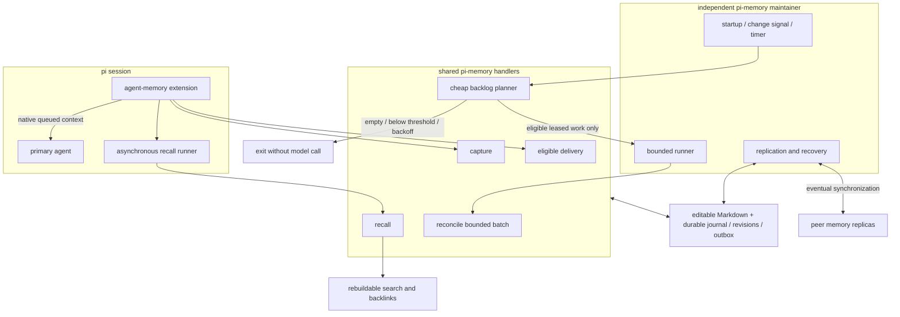

# pi memory simplification

## intent

preserve automatic memory; simplify its machinery. pi owns it. T3 and other hosts are adapters, not dependencies. learning means maintaining external knowledge, not training model weights.

user direction, verbatim:

> “our memory extension becomes the machinery for all the things that need to happen in pi’s turns.”
>
> “they’d task a sub-agent to do it not because there’s a tool telling them to, or specifically for memory, but because that’s what they’d do anyways when searching repos or a codebase.”
>
> “our memory maintainer and such would be some separate process or routine, colocated in our codebase, but independent of  a given agent session surviving.”
>
> “that would only run given enough new stuff to reconcile”
>
> “contracts first, with handlers implementing a contract, and those being exposed through our extensions for different interfaces.”
>
> “tests to prove behavior invariants, NOT testing our own mocks, or contracts the typesystem itself provides.”

one shared core must serve SDK, headless/headful CLI, JSON, extensions and codemode through thin adapters. bring an adapter, not another implementation. supplied source data must not trigger redundant fetching. preserve native session/entry identities and explicit authorization.

### behavior that must survive

- automatically capture authorized experience. preserve particulars, people, possessions, opinions, decisions, disagreements and reasons—not only reusable coding lessons. no demonstrated-future-task-uplift admission gate or routine human fact-approval queue.
- recall asynchronously during turns; primary inference never awaits retrieval/model work. deliver useful, bounded, source-linked context through the native inbox. empty results stay silent; deduplicate and reject expired, wrong-scope, suppressed or obsolete results. ordinary investigation uses existing files/indexes/tools/subagents, not mandatory memory-specific tools.
- keep directly editable, concise linked Markdown: descriptive filenames with permanent id suffixes; id-based link resolution survives renaming. content hashes identify revisions, not notes. model deductions, producer statements and observations are distinguishable; repeated summaries cannot become independent evidence.
- retain dated project experience and judgment; current code/config remains authoritative. memory never grants permissions. procedural improvements belong in repository tests/rationale/guidance; installed skill changes remain governed proposals.
- keep background reconciliation session-independent and backlog-driven: threshold, important correction, maximum age of *pending* work, or recovery. bounded entry windows retain early experience. persist accepted/no-change/ineligible/retry outcomes; empty queues never launch thinking agents. retries back off; unchanged evidence cannot cause endless consolidation.
- acknowledge locally durable writes; operate offline; replicate eventually across the mesh without remote acknowledgment in the foreground. preserve concurrent edits and ancestry, including edits made while pi was stopped. loss of a machine before synchronization can lose its unsynced changes. search indexes are rebuildable; ancestry, suppression and recovery state are not.
- distinguish exposure demotion, supersession, suppression and permanent erasure. suppression constrains admission/relearning and delivery, including a dispatch-time recheck. it does not retroactively erase provider inputs. permanent evidence/Git/transcript/backup deletion is outside this task.

## architecture

contracts live beside handlers in `packages/core/agent-memory`; the extension and CLI consume them. ports name real boundaries: source producer, memory store, search index, consolidation model, native inbox and replica transport. avoid a generic plugin framework. runtime schemas own external validation; derive types rather than maintain two contracts. no partial `success` receipts: locally accepted, indexed, queued and delivered are different states. use stable delivery ids and consumer deduplication, not an unsupported exactly-once promise.

local commit/recovery, revision-checked edits and reconciliation outcomes must share a durable acceptance boundary. unknown edit ancestry is preserved, never permission to overwrite. replica integration must preserve causal ancestry and competing versions; text convergence does not establish factual agreement. replication does not broadcast host-local leases, inbox targets or indexes.

## project: finish the automatic loops

primary owns ordering, contract integration, plan status and final verification. implementation agents own only their assigned files; all read this document before work and at handoff. `[ ]` means unverified, not implicitly deferred. each issue closes with integrated commit ids and behavioral evidence.

| issue | outcome / owned slice | depends on | acceptance | state |
|---|---|---|---|---|
| M0 | inspect consumers; freeze typed contracts, migration boundary and smallest replication/store choice | — | source-derived consumer map; no unresolved owner; decisions recorded here and in contracts | complete — `c41db7cc`; primary boundary corrections below |
| M1 | durable Markdown store, source windows, revisions, journal/outbox and external edits | M0 | real temporary files/process restart; interrupted multi-note commit; early entry beyond old 16/64 KiB limits; stale/unknown-base edits preserved | pending |
| M2 | cheap planner and bounded automatic consolidation | M0, M1 | empty/below-threshold/backoff = zero model work; aged singleton and correction run; durable no-change; replay/crash-after-acceptance loses no coverage | pending |
| M3 | shared asynchronous recall and thin native extension/inbox adapter | M0, M1 | real SDK session proceeds while retrieval waits; relevant text arrives without search/remember calls; obsolete/suppressed/wrong-scope deliveries never enter inbox; duplicate retry harmless | pending |
| M4 | embedded mesh replication and fresh-machine recovery | M0, M1 | real isolated replicas converge offline edits, rename/edit and delete/edit; preserve unresolved alternatives; duplicate/reordered transport and interrupted sync; no Git/network requirement for local acceptance | pending |
| M5 | SDK exports, CLI/JSON adapter, source catch-up and Nix supervisor wiring | M1, M2, M3, M4 | same handlers from direct SDK + real CLI; completed session learned after exit; independent maintenance/recovery; native host evaluation + generated wrapper/activation artifact build | pending |
| M6 | retire superseded frozen catalogs, special tools and Git-gated workflow; update guidance and migration | M3, M5 | consumer/retirement map; source/built registries; old fixture memories import without modifying originals; existing auth, unrelated settings, private data and editable files preserved | pending |
| M7 | adversarial review, final integration and concise handoff | M1–M6 | affected checks rerun at final revision; full pi suite/typecheck/build and real adapter probes; relevant negative controls fail; final diff and remaining platform limits recorded | pending |

parallelism: M2/M3/M4 may proceed independently only after M1's accepted contract/implementation commit. M5 waits for their integration. substantial slices may use isolated worktrees based on an explicitly named dependency commit; uncommitted parent edits do not follow. no overlapping implementation ownership without a declared handoff. the primary alone edits this queue.

### working agreement — every agent

- load `designing-progressive-apis`, `composing-data-driven-ui` (data/handler ownership, not React scaffolding), `shaping-and-shipping-software`, `desloping-code-changes`, `document`, `write`, `git`, and task-specific skills/references. read repository and `modules/pi/AGENTS.md`; for SDK/extension work read the installed pi docs completely and follow relevant links.
- contracts first; use existing APIs and adapters where they satisfy the behavior. justify each new abstraction. a wrapper, inventory, schema or mocked invocation is not a completed feature.
- tests exercise real handlers, temp stores, SDK sessions and processes; mock only external model/network boundaries. do not spend tests re-proving TypeScript or asserting our own mocks. use deterministic inputs and isolated negative controls that demonstrate the verifier detects the intended failure.
- run narrow checks per coherent slice; typecheck pi, targeted inline vitest, and build when exports/manifest/dist change. dependencies require frozen install; Nix wiring requires native host evaluation and consuming artifact build. distinguish source inspection, typechecking, evaluation, build and runtime evidence.
- incrementally commit verified owned files with explicit paths and `type(pi/memory): ...`; retain signing; never squash, amend, force-push, `git add -A`, or discard unrelated work. user authorized commits; do not independently push/merge/deploy. primary integrates commits and owns any publication permission boundary.
- no live canonical memory/session/auth reads, private-data migrations, service activation, installed-skill changes, data deletion or production model probes merely to test. use fixtures. published-code landing is not live fleet activation.
- bound repair/review loops: two unsuccessful attempts then change approach or report a concrete blocker. hand off host/worktree, commits, checks, active/blocked state, unresolved claims and next action. do not silently leave an agreed issue unfinished or call a queued job complete.

### evidence / decisions

baseline: `b934666d`, clean worktree. `pi-memory project-proposals --sync` returned no proposals. verified in source: the extension freezes session prompts and uses keyword search; source projection can retain 64 KiB while evidence admission allows 16 KiB. current CLI and Nix supervisor require Git-remote/canonical machinery. these are implementation observations, not measured live failure rates. see [prior assessment](packages/core/agent-memory/simplification-assessment.md); its earlier manual-memory recommendation is superseded by the intent above.

M0 decision: native immutable, SHA256-addressed changesets and exact Markdown/evidence objects; revision envelopes include ancestry, not only content. no homemade character CRDT or alpha replication library. replicas converge on causal heads and preserved alternatives; ordinary safe merges or semantic reconciliation create a new revision naming all resolved heads. deletions are tombstone revisions; suppression is separate and deny-wins while active.

SQLite coordinates short local transactions/leases only; Markdown and immutable history remain recoverable without operational metadata. reuse file/directory fsync mechanisms, not the existing stale-directory-lock recovery. external editors do not honor application locks: capture current bytes before replacement, preserve unknown-base/late edits, and never silently overwrite an occupied path. a version-preserving materialization/recovery protocol is M1 acceptance, not permission to treat files as a disposable export.

replica transport: bounded immutable exchanges, scoped to explicitly configured authenticated peers; use existing SSH for deployed peers and real local-process/filesystem transports for fixtures. no new public listener or enrollment. received dependencies validate before local publication. host-local leases/outbox targets/indexes never replicate. no Git operation or network acknowledgment gates local acceptance.

source contracts distinguish native sessions from file producers; file edits must not fabricate native session/entry identity. store reads expose all competing heads; no empty-id-list-as-fetch-all convention. deletions are typed, not overloaded demotion strings. native inbox acknowledgment is not durable delivery: retain an outbox and deduplicate from persisted custom-message ids; filter queued/persisted memory again in the SDK context event before provider consumption.

baseline verification: pi build typecheck and existing memory/extension vitest: 30 files / 306 tests passed. contracts also received a targeted compiler configuration because unimported runtime files are outside the normal build include. tests must establish application behavior; upstream marketing, rename-only writes and clean-close recovery do not prove power-loss durability. Darwin needs an explicit stronger flush barrier for stronger guarantees; physical-power-loss testing remains distinct from process-kill recovery.

compatibility boundary: preserve project-proposal transport and explicit historical/manual interfaces until their callers are migrated. retire default personal-memory Git acceptance and frozen exposure machinery, not historical data. local runtime configuration must not require the legacy remote.
