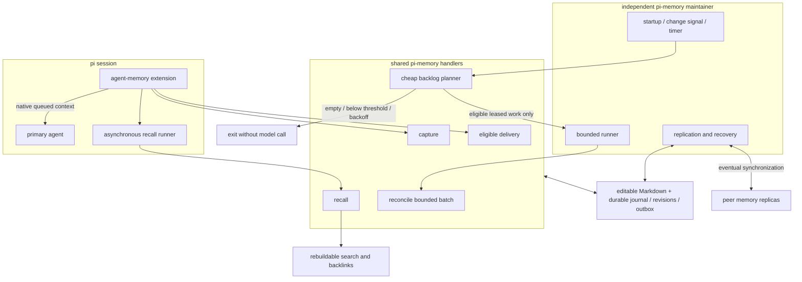

# pi memory simplification

## intent

preserve automatic memory; simplify its machinery. pi owns it. T3 and other hosts are adapters, not dependencies. learning means maintaining external knowledge, not training model weights.

user direction, verbatim:

> “our memory extension becomes the machinery for all the things that need to happen in pi’s turns.”
>
> “they’d task a sub-agent to do it not because there’s a tool telling them to, or specifically for memory, but because that’s what they’d do anyways when searching repos or a codebase.”
>
> “our memory maintainer and such would be some separate process or routine, colocated in our codebase, but independent of  a given agent session surviving.”
>
> “that would only run given enough new stuff to reconcile”
>
> “contracts first, with handlers implementing a contract, and those being exposed through our extensions for different interfaces.”
>
> “tests to prove behavior invariants, NOT testing our own mocks, or contracts the typesystem itself provides.”

one shared core must serve SDK, headless/headful CLI, JSON, extensions and codemode through thin adapters. bring an adapter, not another implementation. supplied source data must not trigger redundant fetching. preserve native session/entry identities and explicit authorization.

### behavior that must survive

- automatically capture authorized experience. preserve particulars, people, possessions, opinions, decisions, disagreements and reasons—not only reusable coding lessons. no demonstrated-future-task-uplift admission gate or routine human fact-approval queue.
- recall asynchronously during turns; primary inference never awaits retrieval/model work. deliver useful, bounded, source-linked context through the native inbox. empty results stay silent; deduplicate and reject expired, wrong-scope, suppressed or obsolete results. ordinary investigation uses existing files/indexes/tools/subagents, not mandatory memory-specific tools.
- keep directly editable, concise linked Markdown: descriptive filenames with permanent id suffixes; id-based link resolution survives renaming. content hashes identify revisions, not notes. model deductions, producer statements and observations are distinguishable; repeated summaries cannot become independent evidence.
- retain dated project experience and judgment; current code/config remains authoritative. memory never grants permissions. procedural improvements belong in repository tests/rationale/guidance; installed skill changes remain governed proposals.
- keep background reconciliation session-independent and backlog-driven: threshold, important correction, maximum age of *pending* work, or recovery. bounded entry windows retain early experience. persist accepted/no-change/ineligible/retry outcomes; empty queues never launch thinking agents. retries back off; unchanged evidence cannot cause endless consolidation.
- acknowledge locally durable writes; operate offline; replicate eventually across the mesh without remote acknowledgment in the foreground. preserve concurrent edits and ancestry, including edits made while pi was stopped. loss of a machine before synchronization can lose its unsynced changes. search indexes are rebuildable; ancestry, suppression and recovery state are not.
- distinguish exposure demotion, supersession, suppression and permanent erasure. suppression constrains admission/relearning and delivery, including a dispatch-time recheck. it does not retroactively erase provider inputs. permanent evidence/Git/transcript/backup deletion is outside this task.

## architecture



contracts live beside handlers in `packages/core/agent-memory`; the extension and CLI consume them. ports name real boundaries: source producer, memory store, search index, consolidation model, native inbox and replica transport. avoid a generic plugin framework. runtime schemas own external validation; derive types rather than maintain two contracts. no partial `success` receipts: locally accepted, indexed, queued and delivered are different states. use stable delivery ids and consumer deduplication, not an unsupported exactly-once promise.

local commit/recovery, revision-checked edits and reconciliation outcomes must share a durable acceptance boundary. unknown edit ancestry is preserved, never permission to overwrite. replica integration must preserve causal ancestry and competing versions; text convergence does not establish factual agreement. replication does not broadcast host-local leases, inbox targets or indexes.

## project: finish the automatic loops

primary owns ordering, contract integration, plan status and final verification. implementation agents own only their assigned files; all read this document before work and at handoff. `[ ]` means unverified, not implicitly deferred. each issue closes with integrated commit ids and behavioral evidence.

| issue | outcome / owned slice | depends on | acceptance | state |
|---|---|---|---|---|
| M0 | inspect consumers; freeze typed contracts, migration boundary and smallest replication/store choice | — | source-derived consumer map; no unresolved owner; decisions recorded here and in contracts | complete — `c41db7cc`; primary boundary corrections below |
| M1 | durable Markdown store, revisions, journal/outbox and external edits | M0 | real temporary files/process restart; interrupted multi-note commit; stale/unknown-base edits preserved | complete — `390659ce`, `6614fa1b`, `8a7b0c8e`; real recovery/edit/restore checks pass |
| M2 | cheap planner and bounded automatic consolidation | M0, M1 | empty/below-threshold/backoff = zero model work; aged singleton and correction run; durable no-change; replay/crash-after-acceptance loses no coverage | complete — `79032600`, `8c9aef4f`, `37121090`; lifecycle, roles and historical suppression verified |
| M3 | shared asynchronous recall and thin native extension/inbox adapter | M0, M1 | real SDK session proceeds while retrieval waits; relevant text arrives without search/remember calls; obsolete/suppressed/wrong-scope deliveries never enter provider context; duplicate retry harmless | complete — through `feb92194`, settlement race `de185f17`; default adapter and long-run provider/source checks pass |
| M4 | embedded mesh replication and fresh-machine recovery | M0, M1 | real isolated replicas converge offline edits, rename/edit and delete/edit; preserve unresolved alternatives; duplicate/reordered transport and interrupted sync; no Git/network requirement for local acceptance | complete — `416995a7`, `2e16a8c1`, `0d296178`; continuity, byte/count recovery and implicit-dependency controls pass |
| M5a | native source producer and bounded live/disk entry windows | M0; integration with M1 | identical live/catch-up identities; supplied entries do not reread; early/oversized UTF-8 parts retain complete coverage and attribution | complete — `70ba49d7`, `a441547c`, `de57e479`; live/catch-up share identities/context and restore-checked receipts |
| M5 | SDK exports, CLI/JSON adapter, source catch-up and Nix supervisor wiring | M1, M2, M3, M4, M5a | same handlers from direct SDK + real CLI; completed session learned after exit; independent maintenance/recovery; native host evaluation + generated wrapper/activation artifact build | complete — through `c7acc55b`, project scheduling `805fe52e`; darwin evaluated + activation artifact built |
| M6 | retire superseded frozen catalogs, special tools and Git-gated workflow; update guidance and migration | M3, M5 | consumer/retirement map; source/built registries; old fixture memories import without modifying originals; existing auth, unrelated settings, private data and editable files preserved | complete — `e76cd81f`, coexistence guard `38871600`; source/built gates and non-destructive import fixtures pass |
| M7 | adversarial review, final integration and concise handoff | M1–M6 | affected checks rerun at final revision; full pi suite/typecheck/build and real adapter probes; relevant negative controls fail; final diff and remaining platform limits recorded | complete — two bounded adversarial rounds repaired; 93 files / 1187 tests pass, 5 skipped; final checks/limits below |

parallelism: M1 and M5a own disjoint store/producer files and agree the window hash boundary before integration. primary prepares native runtime configuration independently; CLI/export/supervisor integration still waits for its declared dependencies. M2/M3/M4 may proceed independently only after M1's accepted contract/implementation commit. M5 waits for their integration. substantial slices may use isolated worktrees based on an explicitly named dependency commit; uncommitted parent edits do not follow. no overlapping implementation ownership without a declared handoff. the primary alone edits this queue.

### working agreement — every agent

- load `designing-progressive-apis`, `composing-data-driven-ui` (data/handler ownership, not React scaffolding), `shaping-and-shipping-software`, `desloping-code-changes`, `document`, `write`, `git`, and task-specific skills/references. read repository and `modules/pi/AGENTS.md`; for SDK/extension work read the installed pi docs completely and follow relevant links.
- contracts first; use existing APIs and adapters where they satisfy the behavior. justify each new abstraction. a wrapper, inventory, schema or mocked invocation is not a completed feature.
- tests exercise real handlers, temp stores, SDK sessions and processes; mock only external model/network boundaries. do not spend tests re-proving TypeScript or asserting our own mocks. use deterministic inputs and isolated negative controls that demonstrate the verifier detects the intended failure.
- run narrow checks per coherent slice; typecheck pi, targeted inline vitest, and build when exports/manifest/dist change. dependencies require frozen install; Nix wiring requires native host evaluation and consuming artifact build. distinguish source inspection, typechecking, evaluation, build and runtime evidence.
- incrementally commit verified owned files with explicit paths and `type(pi/memory): ...`; retain signing; never squash, amend, force-push, `git add -A`, or discard unrelated work. user authorized commits; do not independently push/merge/deploy. primary integrates commits and owns any publication permission boundary.
- no live canonical memory/session/auth reads, private-data migrations, service activation, installed-skill changes, data deletion or production model probes merely to test. use fixtures. published-code landing is not live fleet activation.
- bound repair/review loops: two unsuccessful attempts then change approach or report a concrete blocker. hand off host/worktree, commits, checks, active/blocked state, unresolved claims and next action. do not silently leave an agreed issue unfinished or call a queued job complete.

### evidence / decisions

baseline: `b934666d`, clean worktree. `pi-memory project-proposals --sync` returned no proposals. verified in source: the extension freezes session prompts and uses keyword search; source projection can retain 64 KiB while evidence admission allows 16 KiB. current CLI and Nix supervisor require Git-remote/canonical machinery. these are implementation observations, not measured live failure rates. see [prior assessment](packages/core/agent-memory/simplification-assessment.md); its earlier manual-memory recommendation is superseded by the intent above.

M0 decision: native immutable, SHA256-addressed changesets and exact Markdown/evidence objects; revision envelopes include ancestry, not only content. no homemade character CRDT or alpha replication library. replicas converge on causal heads and preserved alternatives; ordinary safe merges or semantic reconciliation create a new revision naming all resolved heads. deletions are tombstone revisions; suppression is separate and deny-wins while active.

SQLite coordinates short local transactions/leases only; Markdown and immutable history remain recoverable without operational metadata. reuse file/directory fsync mechanisms, not the existing stale-directory-lock recovery. external editors do not honor application locks: capture current bytes before replacement, preserve unknown-base/late edits, and never silently overwrite an occupied path. a version-preserving materialization/recovery protocol is M1 acceptance, not permission to treat files as a disposable export.

replica transport: bounded immutable exchanges, scoped to explicitly configured authenticated peers; use existing SSH for deployed peers and real local-process/filesystem transports for fixtures. no new public listener or enrollment. received dependencies validate before local publication. host-local leases/outbox targets/indexes never replicate. no Git operation or network acknowledgment gates local acceptance.

capture defaults to owner-authorized personal source windows, with optional producer-observed project identity. one reconciliation may retain personal experience and narrow project decisions to that exact project; restricted project evidence cannot widen into personal memory. personal and current-project recall are separate scope-filtered queries, not duplicate source/model passes.

source contracts distinguish native sessions from file producers; file edits must not fabricate native session/entry identity. store reads expose all competing heads; no empty-id-list-as-fetch-all convention. deletions are typed, not overloaded demotion strings. an intermediate worker response is not native persistence: retain the outbox until a persisted native marker acknowledges it. validate marker details against the original accepted delivery, not self-asserted metadata; deduplicate and recheck eligibility before provider consumption. materialize new memory bodies only in request-local context, not compactor input. preserve ordinary native summaries and user/assistant history; suppression is not retroactive conversation erasure.

baseline verification: pi build typecheck and existing memory/extension vitest: 30 files / 306 tests passed. native producer integration typechecks and its 6 real-SDK/filesystem cases pass (9 tests including runtime configuration); byte-coverage and producer-role negative controls detect dropped parts/misattribution. local SSH verification against the configured public signing key reports good signatures for all 8 commits through `de57e479`. native runtime configuration now typechecks and passes 3 real-filesystem tests: supplied snapshots bypass corrupt settings, environment/native namespace selection works without Git, unrelated keys/bytes remain untouched, and malformed external options refuse unsafe fallback. contracts also received a targeted compiler configuration because unimported runtime files are outside the normal build include. tests must establish application behavior; upstream marketing, rename-only writes and clean-close recovery do not prove power-loss durability. Darwin needs an explicit stronger flush barrier for stronger guarantees; physical-power-loss testing remains distinct from process-kill recovery.

M1 integration verification: all runtime modules typecheck; 35 tests pass, including real process-kill/publication/flush-failure recovery, immutable-dependency negative control, and project-scope narrowing without widening. source and store now share one identity protocol. synchronous SQLite/filesystem work must run outside the primary inference event loop in M3. final review must check malformed editable-note isolation and prevent invalid files from stopping unrelated capture.

integration evidence: `6614fa1b` isolates malformed editable metadata and repairs restored-peer anti-entropy despite stale ACKs. `8a7b0c8e` rebinds recovery artifacts after a closed snapshot moves roots. integrated store/source/replica checks passed 47 tests; M2 integration passed 69 runtime tests including one leased personal/project batch and zero-threshold empty/singleton behavior. the explicit same-owner project grant passes an actual subprocess exchange and rejects foreign-owner notes. M3 follow-up typechecks and passes 18 targeted real SDK/file cases: blocked retrieval, provider/compactor inputs, preserved summaries, suppression, receipt forgery, pre-enqueue reopen, durable dedup and ordinary tools. full source/built/Nix evidence is still pending; no physical-power-loss or live-fleet claim.

two bounded adversarial rounds reproduced and repaired history-count/byte ceilings, restored source/receiver checkpoints, unattended project backlog and parentless evidence disclosure. `5eb950ad` binds proof epochs to retained payload continuity; `3e939457`/`6170e0fa` resolve implicit ownership without later duplicates changing cached dependencies; `416995a7`, `2e16a8c1`, `0d296178` apply the guarded incremental proofs. known-failure controls reject the old lifetime ceiling, unsafe graft cache, weaker v2 predicate and revision-bound suppression. the full-suite recall race was real capture-write contention, not a looser timing assertion: `de185f17` defers publication without raising the 250 ms eligibility budget. ordinary finalized-source capture also passes a real 40-tool-turn run; an unnecessary serialization candidate was removed when its negative control did not demonstrate a defect.

### consumer / retirement boundary

| consumer | current owner / retained exception |
|---|---|
| default extension | worker capture/recall + authenticated persisted marker; no frozen catalog or memory-specific tools |
| SDK / CLI / JSON | shared runtime handlers, inert imports; source/built/bin-symlink fixtures |
| independent Nix supervisor | native bounded `maintain`, editable lower-priority peer defaults; generated darwin launch agent inspected after activation-package build, not activated |
| global guidance | automatic context plus ordinary intentional investigation; no mandatory memory-tool ritual |
| codemode integration gate | actual provider body plus absent retired tools; disabling recall and clobbering unrelated text each produce the intended failure |
| explicit legacy manual commands / project proposals | retained dispatcher; legacy whole-root materialization cannot replace an enrolled native runtime or discard an interrupted native backup |
| ordinary qmd collection | legacy verified projection only; no native semantic-index or fleet-convergence claim |

remaining old-tool/catalog strings belong to compatibility/evaluation fixtures. replay discovery with `rg -n 'memory_(search|open)|memory_catalog|PI_AGENT_MEMORY_PROMPT_WORKER|pi-memory (maintain|propose)' config modules/pi modules/agents modules/pi-memory modules/node-pnpm --glob '!pnpm-lock.yaml'`; the real source/built registry gates replace a second generated catalog.

compatibility boundary: preserve project-proposal transport and explicit historical/manual interfaces until their callers are migrated. `modules/agents/skills/remember/SKILL.md` still consumes `propose`, `proposals`, `show`, `review` and `history verify`; installed-skill changes are excluded. keep their legacy dispatch isolated rather than deleting those callers' backend or making Git the new default. the ordinary `agent-memories` qmd collection remains a legacy projection until a filtered native projection replaces its Nix wiring. retire default frozen exposure and special tools, not historical data. local runtime configuration must not require the legacy remote.

## final verification / handoff

code revision: `0d296178`; darwin arm64, Node `24.18.0`. documentation-only closeout follows that tested code. this is the pre-deployment verification snapshot; the deployment record below supersedes its publication/activation state.

from `modules/pi`, all passed:

```sh
pnpm exec tsc -p tsconfig.build.json --noEmit
pnpm run build
pnpm run test --maxWorkers=2
node scripts/check-codemode.ts
node scripts/check-codemode.ts --built
PI_TEST_BUILT_TOOLS=1 pnpm exec vitest run --maxWorkers=2 packages/core/prompt-patch
```

full suite: **93 files, 1187 passed, 5 skipped**. built/source provider-request checks: **26 passed**. real CLI checks prove automatic body delivery without memory tools and preserve ordinary tooling; negative recall-disabled and text-clobber runs fail their intended assertions. built SDK import/export probe is inert and supplied project metadata bypasses discovery. explicit fixture imports preserve originals; no actual private-data import ran. final local Markdown links and scoped diff are checked; commit signatures use a temporary public-key allowlist, not permanent Git configuration.

from the repository root, native configuration evaluated and the consuming activation artifact built:

```sh
nix eval --raw --no-write-lock-file '.#darwinConfigurations.mbp-m2.system.drvPath'
nix build --no-link --no-write-lock-file '.#darwinConfigurations.mbp-m2.config.home-manager.users.bdsqqq.home.activationPackage'
```

the generated launch agent was inspected: store-readiness shell wrapper, native `maintain`, RunAtLoad and 60-second cadence; its live-source loader and lower-priority roster defaults match the module. this is an **artifact build**, not activation or a full host build.

limits: no push/publication, service activation, installed-skill edit, private-data migration, production provider request or live SSH/DNS/fleet probe. Linux evaluation/build/runtime and physical-power-loss behavior remain unverified; native-only checks avoid pretending cross-platform execution. semantic recall reports unavailable and uses lexical/alias/link association; ordinary qmd remains legacy. native session snapshots are loaded before bounded windows are selected. unfinished, hard-killed in-memory runs can lose unpublished captures; persistent sessions have independent catch-up. suppression is not retroactive conversation/history/backup erasure. real deployment and any explicit legacy import require their own authorization and verification.

## deployment — 2026-10-18

user authorized merge, push/publication and local activation. `c87ec481` merged the signed implementation history into `main` without squashing; `50c0e38e` fixed default peer selection to use Darwin's short hostname rather than `mbp-m2.local`. both are pushed. [publication CI](https://github.com/bdsqqq/dots/actions/runs/39135594580) built and passed **93 files / 1186 tests, 6 skipped** on Linux with built-tool checks, then published `@bdsqqq/pi@0.0.1792333611-gc87ec48`; npm's `gitHead` matches `c87ec481`.

on mbp-m2, the actual Pi launcher and extension paths resolve to the live `main` checkout, not the T3 server artifact under `~/.local/share/t3-pi`. frozen dependency installation, typecheck, build and source/built CLI checks passed there. the full Darwin host closure for `50c0e38e` built. existing Pi sessions still need reload/restart to consume changed extensions and guidance.

applied only the generated Home Manager memory LaunchAgent in the user GUI domain: stopped the legacy job, preserved its old plist, installed the exact generated replacement and bootstrapped it. the service runs native `maintain` every 60 seconds; the first native cycle exited 0 and reported `locally-committed`, with the native store subsequently reporting four notes. corrected defaults contain only `lgo-z2e` and `htz-xfs-lab`. the generated service closure is pinned at `~/.local/state/pi-memory/service-generation` until full activation. no explicit legacy/private-data import ran; automatic native capture/consolidation is now operating normally.

**remaining boundaries:** full nix-darwin/profile activation failed because `sudo -n` requires a password. finish in a user terminal with `cd ~/commonplace/01_files/nix && sudo darwin-rebuild switch --flake .#mbp-m2 --no-write-lock-file`; then check the profile's `pi-memory` wrapper and service again. the first live replication attempts reported remote process/timeout errors; local operation is proven, fleet convergence is NOT. no remote-host activation was performed. physical-power-loss and semantic-quality limits above still apply.
